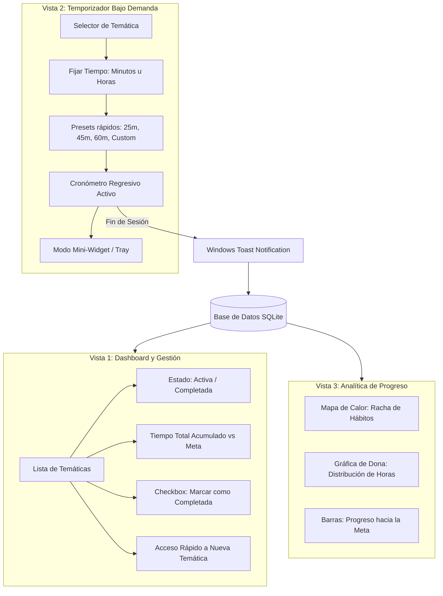
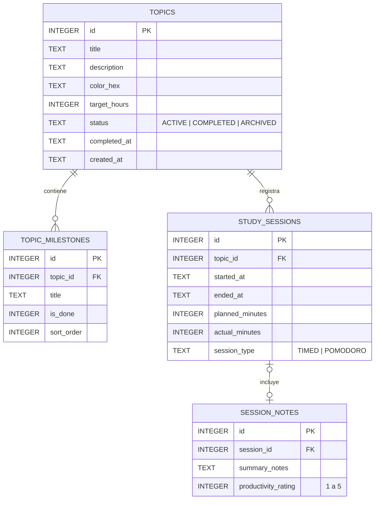

# Especificación Formal de Requisitos y Arquitectura del Sistema
## Programador y Monitor de Estudios Local para Windows 11

**Ecosistema**: C# (.NET 8) | SQLite | Fluent Design (Windows 11) | Notificaciones Nativa WinRT / Toasts

---

## 1. Visión y Ficha Técnica

Una aplicación de escritorio de alto rendimiento orientada al seguimiento disciplinado del estudio personal, construida sobre el ecosistema nativo de Microsoft Windows para garantizar:
- Consumo mínimo de recursos (< 50 MB RAM).
- Arranque instantáneo.
- Estética 100% integrada con las directrices visuales de Windows 11 (Mica, Acrílico, bordes redondeados).
- Notificaciones interactivas en el Action Center con sonidos del sistema y botones de acción rápida.

```
┌────────────────────────────────────────────────────────┐
│                   Arquitectura C# (.NET 8)             │
├────────────────────────────────────────────────────────┤
│  UI: WPF con Wpf.Ui (Fluent Design Windows 11) / WinUI │
│  Patrón: MVVM (CommunityToolkit.Mvvm)                  │
│  Notificaciones: Microsoft.Toolkit.Uwp.Notifications   │
│  Persistencia: Microsoft.Data.Sqlite + Dapper          │
│  Gráficos: LiveCharts2 (SkiaSharp acelerado por GPU)   │
└────────────────────────────────────────────────────────┘
```

---

## 2. Refinamiento de Requisitos Funcionales



### 2.1. Gestión de Temáticas y Dashboard Principal
* **RF-01 (Dashboard de Temáticas)**: Pantalla de inicio con vista tipo tarjeta o tabla moderna que lista todas las temáticas registradas con:
  - Nombre de la temática y etiqueta visual de color.
  - Tiempo acumulado estudiado (formato `HH:MM:SS` o `X.X horas`).
  - Indicador de estado: **En curso / Activa**, **En pausa** o **Completada**.
  - **Marcaje de Temática Completada**: Selector/Checkbox que permite dar por concluido el estudio de dicha materia, archivándola opcionalmente para que no sature la vista diaria.
  - Barra de progreso porcentual relativa a la meta de horas fijada por el usuario (si aplica).
* **RF-02 (Alta y Edición Rápida de Temáticas)**: Diálogo modal ligero para registrar una nueva materia en cualquier momento:
  - Campos: Nombre (obligatorio), Meta de horas objetivo (opcional), Color identificador (paleta Windows 11), Notas iniciales.

### 2.2. Motor de Temporizador Bajo Demanda
* **RF-03 (Configuración de Sesión)**:
  - Selección de la temática a estudiar.
  - Selección de duración en minutos u horas mediante selector numérico o botones rápidos (*Presets*: 25m Pomodoro, 45m Bloque Estándar, 60m Deep Work, o valor personalizado).
* **RF-04 (Control de Ejecución)**:
  - Estados: *Iniciado*, *En pausa*, *Reanudado*, *Detenido anticipadamente*.
  - Alerta sonora y visual al alcanzar el 100% del tiempo.
* **RF-05 (Integración con Notificaciones de Windows 11)**:
  - Uso de **Toast Notifications nativas de Windows**:
    - **Notificación de Inicio**: Alerta discreta con la materia y tiempo fijado.
    - **Notificación de Fin**: Alerta emergente en el Action Center con sonido nativo y botones interactivos:
      - `[Descanso (5 min)]`
      - `[Extender 15 min]`
      - `[Finalizar y Registrar]`

### 2.3. Visualización y Métricas de Progreso
* **RF-06 (Módulo Estadístico)**: Gráficos de rendimiento y consistencia (ver análisis comparativo en la Sección 3).
* **RF-07 (Registro Detallado)**: Almacenamiento por sesión: `Fecha/Hora Inicio`, `Fecha/Hora Fin`, `Minutos Efectivos`, `Temática`, `Notas de lo aprendido` (opcional).

---

## 3. Propuesta de Visualización: ¿Mapa de Calor o Gráficos Estadísticos?

### Análisis Comparativo

| Tipo de Visualización | Qué mide mejor | Experiencia Psicológica del Usuario | Esfuerzo de Implementación |
| :--- | :--- | :--- | :---: |
| **Mapa de Calor (Estilo GitHub Contribution Matrix)** | **Consistencia y Hábitos diarios**: Muestra qué días se estudió y con qué intensidad (cuadrículas por día con gradiente de color según minutos dedicados). | **Muy Alto (Efecto Racha / Streak)**: Fomenta la disciplina de "no romper la cadena" diaria. | Medio (renderizado en canvas / LiveCharts) |
| **Gráficos Estadísticos (Dona / Barras)** | **Distribución y Cumplimiento de Metas**: Porcentaje de tiempo asignado a cada materia y avance hacia la meta total. | **Alto para Organización**: Responde a "¿en qué materia estoy retrasado?" y "¿cuántas horas llevo este mes?". | Bajo (librería de gráficos estándar) |

### Decisión Recomendada: **Dashboard Híbrido Complementario**

No son mutuamente excluyentes, sino que responden a dos preguntas distintas del estudiante:
1. **Gráfico Superior (Mapa de Calor de Hábitos)**: "¿He sido constante este mes?". Muestra la cuadrícula de los últimos 3 a 6 meses con la racha activa de días estudiados.
2. **Gráficos Inferiores (Distribución y Progreso)**:
   - **Gráfico de Dona**: Porcentaje de horas dedicadas por temática (ej. 45% Matemáticas, 35% Algoritmos, 20% Historia).
   - **Gráfico de Barras Horizontales**: Comparativa de `Horas Actuales` vs `Meta Objetivo` por materia.

---

## 4. Sugerencias Estructurales para Potenciar la Aplicación

Para transformar un simple cronómetro en una herramienta de estudio integral de alto valor, se sugieren estas 4 características modulares:

### A. Subtemas o Checklist de Hitos por Temática (Desglose Jerárquico)
* *Problema*: Marcar una temática como "Completada" de un solo golpe es poco realistic en materias extensas (ej. "Aprender C#").
* *Solución*: Cada temática puede tener una lista rápida de tareas o capítulos (ej. *1. Sintaxis básica*, *2. POO*, *3. SQLite*). Conforme el usuario marca hitos, el progreso de la materia avanza automáticamente y cuando todos están listos, la temática pasa a "Completada".

### B. Mini-Widget Flotante o Modo "Picture-in-Picture"
* Al iniciar el temporizador, el usuario no necesita ver toda la ventana grande del dashboard.
* La ventana principal puede minimizar a la bandeja del sistema (System Tray) o convertirse en una **píldora flotante compacta y traslúcida** siempre visible en una esquina de la pantalla con el tiempo restante y botón de pausa.

### C. Bitácora de Cierre de Sesión (Micro-Journaling de Estudio)
* Cuando suena la campana de fin de sesión, un diálogo simple de 1 línea le pregunta: *"¿Qué tema clave aprendiste hoy?"*.
* Esta anotación queda vinculada al historial, permitiendo al usuario revisar qué vio semanas atrás (clave para la técnica de Repetición Espaciada / Active Recall).

### D. Selector de Modo: Pomodoro vs. Bloque Libre (Deep Work)
* Ofrecer dos modalidades en el selector:
  1. **Modo Pomodoro**: Automatiza los intervalos (25 min estudio / 5 min descanso / 15 min descanso largo).
  2. **Modo Libre / Deep Work**: El usuario fija el tiempo total deseado (ej. 90 min) sin interrupciones.

---

## 5. Esquema Relacional de Base de Datos (SQLite)



### Tablas e Índices (DDL SQLite)

```sql
PRAGMA foreign_keys = ON;

-- 1. Temáticas
CREATE TABLE IF NOT EXISTS topics (
    id INTEGER PRIMARY KEY AUTOINCREMENT,
    title TEXT NOT NULL,
    description TEXT,
    color_hex TEXT DEFAULT '#0078D4',
    target_hours REAL DEFAULT 0,
    status TEXT NOT NULL DEFAULT 'ACTIVE' CHECK(status IN ('ACTIVE', 'COMPLETED', 'ARCHIVED')),
    completed_at TEXT,
    created_at TEXT NOT NULL DEFAULT CURRENT_TIMESTAMP
);

-- 2. Hitos o capítulos dentro de una temática
CREATE TABLE IF NOT EXISTS topic_milestones (
    id INTEGER PRIMARY KEY AUTOINCREMENT,
    topic_id INTEGER NOT NULL,
    title TEXT NOT NULL,
    is_done INTEGER NOT NULL DEFAULT 0 CHECK(is_done IN (0, 1)),
    sort_order INTEGER NOT NULL DEFAULT 0,
    FOREIGN KEY(topic_id) REFERENCES topics(id) ON DELETE CASCADE
);

-- 3. Sesiones de estudio registradas
CREATE TABLE IF NOT EXISTS study_sessions (
    id INTEGER PRIMARY KEY AUTOINCREMENT,
    topic_id INTEGER NOT NULL,
    started_at TEXT NOT NULL,
    ended_at TEXT NOT NULL,
    planned_minutes INTEGER NOT NULL,
    actual_minutes INTEGER NOT NULL,
    session_type TEXT DEFAULT 'TIMED',
    notes TEXT,
    created_at TEXT NOT NULL DEFAULT CURRENT_TIMESTAMP,
    FOREIGN KEY(topic_id) REFERENCES topics(id) ON DELETE CASCADE
);

-- Índices de consulta rápida para el Dashboard y Mapa de Calor
CREATE INDEX IF NOT EXISTS idx_sessions_topic ON study_sessions(topic_id);
CREATE INDEX IF NOT EXISTS idx_sessions_dates ON study_sessions(started_at);
```

---

## 6. Arquitectura del Proyecto en C# (.NET 8)

Estructura de solución recomendada siguiendo el patrón **MVVM**:

```
StudyTracker.sln
├── src/
│   ├── StudyTracker.Core/             [Lógica pura / SDD]
│   │   ├── Models/                    (Topic, StudySession, Milestone)
│   │   ├── Interfaces/                (ITopicRepository, ISessionRepository, ITimerService)
│   │   ├── Services/
│   │   │   ├── TimerService.cs        (Temporizador con eventos tick/complete)
│   │   │   ├── StatsService.cs        (Cálculo de mapa de calor y horas acumuladas)
│   │   │   └── NotificationService.cs (Despachador de Toasts de Windows)
│   │   └── Data/
│   │       ├── DatabaseInitializer.cs (Creación de esquema SQLite)
│   │       └── Repositories/          (Acceso a datos con SQLite)
│   │
│   └── StudyTracker.UI/               [Presentación Fluent / ODD]
│       ├── Views/
│       │   ├── DashboardView.xaml     (Listado de temáticas, estado y resumen)
│       │   ├── TimerView.xaml         (Temporizador activo y presets de tiempo)
│       │   ├── StatsView.xaml         (Mapa de calor + Gráficos de dona/barra)
│       │   └── MiniTimerWindow.xaml   (Widget flotante compacto)
│       ├── ViewModels/
│       │   ├── DashboardViewModel.cs
│       │   ├── TimerViewModel.cs
│       │   └── StatsViewModel.cs
│       └── Assets/                    (Iconos, estilos de Fluent Design)
│
└── tests/
    └── StudyTracker.Core.Tests/       [Pruebas Unitarias de tiempo y persistencia]
```

---

## 7. Plan de Ejecución por Etapas

| Fase | Enfoque | Alcance |
| :--- | :---: | :--- |
| **Fase 1: Core & SQLite** | **SDD** | Configuración de la solución .NET 8, modelos, inicializador de base de datos SQLite y pruebas unitarias de repositorios. |
| **Fase 2: Motor de Tiempo & Toasts** | **SDD** | `TimerService` con eventos precisos y `NotificationService` con Microsoft.Toolkit.Uwp.Notifications (Toasts interactivos de Windows 11). |
| **Fase 3: Dashboard y Gestión de Temáticas** | **ODD** | Ventana principal moderna con Fluent UI: lista de temáticas, selector de estado (activo/completado), diálogo de nueva temática y visualización de horas. |
| **Fase 4: Vista de Temporizador & Mini-Widget** | **ODD** | Pantalla del temporizador bajo demanda con selector de minutos/horas y opción de minimizar a la bandeja o a mini-widget flotante. |
| **Fase 5: Métricas (Mapa de Calor + Gráficas)** | **ODD** | Integración del mapa de calor de actividad diaria y gráfico de distribución de temáticas con LiveCharts2. |
