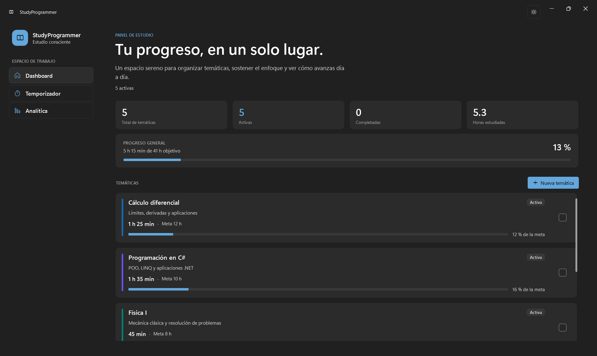
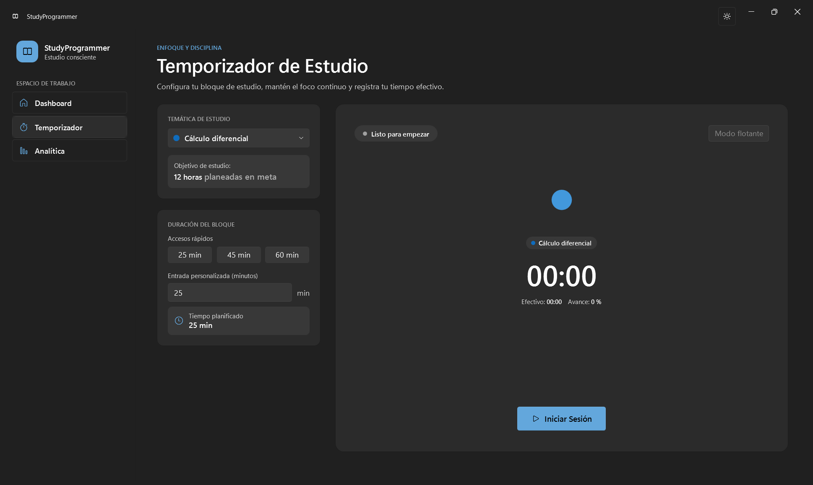
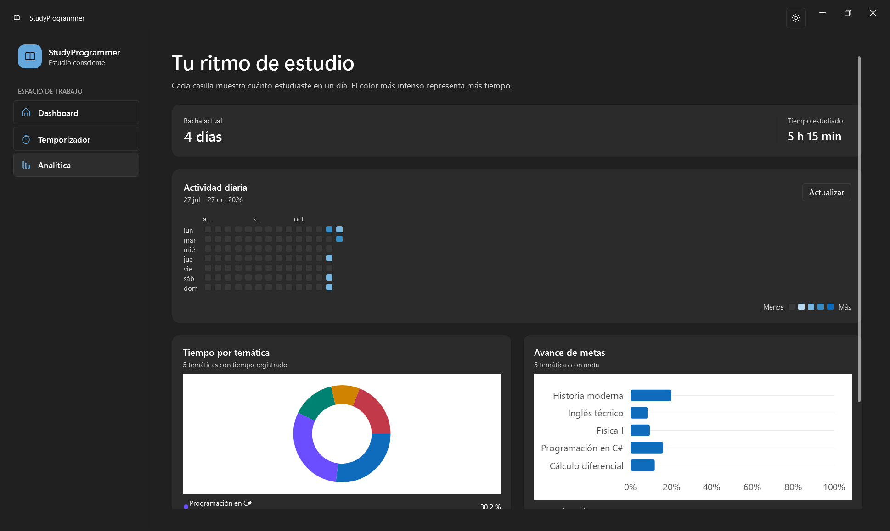

# StudyProgrammer

StudyProgrammer es una aplicación de escritorio para Windows que ayuda a
organizar temáticas, concentrar bloques de estudio y revisar el progreso.
Funciona de forma local: los datos permanecen en una base SQLite del usuario
y no se necesita una cuenta ni un servidor.

## Capturas

Las imágenes se tomaron de la aplicación de Windows en ejecución. Para mostrar
el dashboard y las gráficas, se cargaron datos ficticios de demostración que
se eliminaron después; la base de desarrollo quedó vacía.

### Dashboard



### Temporizador



### Analítica



## Funciones principales

- Crear temáticas con descripción, color y meta de horas; consultar su avance
  y marcarlas como completadas.
- Programar sesiones con accesos rápidos de 25, 45 o 60 minutos, o indicar
  una duración personalizada. Pausar o detener el temporizador cuando sea
  necesario.
- Registrar el tiempo efectivo y una nota al cerrar una sesión.
- Usar el temporizador flotante y los controles de la bandeja del sistema.
- Consultar actividad diaria, racha de estudio, tiempo por temática y avance
  de las metas.
- Cambiar entre los temas claro y oscuro.

## Requisitos

- Windows 10 de 64 bits, versión 19041 o posterior, o Windows 11.
- Para desarrollar o compilar: .NET 8 SDK.
- La publicación para Windows x64 es autocontenida; no requiere instalar el
  runtime de .NET por separado.

SQLite está integrado en la aplicación mediante `Microsoft.Data.Sqlite`.
No hace falta instalar un motor, servicio o contenedor de base de datos.
La aplicación crea la carpeta, el archivo y el esquema al iniciarse por
primera vez.

## Ejecutar la aplicación publicada

Desde la raíz del proyecto:

```powershell
.\artifacts\StudyProgrammer-final-win-x64\StudyTracker.UI.exe
```

La carpeta `artifacts` está excluida de Git. Para generar la publicación,
consulta las instrucciones siguientes.

## Instalador para Windows

El MVP se distribuye con un instalador por usuario para Windows x64. No pide
permisos de administrador, instala la aplicación en el perfil del usuario,
crea un acceso directo en el menú Inicio y ofrece crear otro en el escritorio.
El desinstalador elimina la aplicación, pero conserva la base de datos del
usuario en `%LOCALAPPDATA%\StudyTracker`.

El instalador compilado queda en
`artifacts\installer\StudyProgrammer-Setup-0.1.0-win-x64.exe`. Para generarlo
desde la raíz del repositorio, instala Inno Setup 6 y ejecuta:

```powershell
dotnet publish .\src\StudyTracker.UI\StudyTracker.UI.csproj -p:PublishProfile=win-x64
$iscc = @(
  "$env:LOCALAPPDATA\Programs\Inno Setup 6\ISCC.exe",
  "${env:ProgramFiles(x86)}\Inno Setup 6\ISCC.exe",
  "$env:ProgramFiles\Inno Setup 6\ISCC.exe"
) | Where-Object { Test-Path $_ } | Select-Object -First 1
if (-not $iscc) { throw "No se encontró ISCC.exe de Inno Setup 6." }
& $iscc .\installer\StudyProgrammer.iss
if ($LASTEXITCODE -ne 0) { throw "Falló la compilación del instalador." }
```

El script fuente del instalador está en `installer\StudyProgrammer.iss`.

## Desarrollo

Restaurar, compilar y ejecutar las pruebas desde la raíz:

```powershell
dotnet restore .\StudyTracker.sln
dotnet build .\StudyTracker.sln
dotnet test .\StudyTracker.sln
```

Iniciar la interfaz durante el desarrollo:

```powershell
dotnet run --project .\src\StudyTracker.UI\StudyTracker.UI.csproj
```

Publicar la versión autónoma para Windows x64:

```powershell
dotnet publish .\src\StudyTracker.UI\StudyTracker.UI.csproj -p:PublishProfile=win-x64
```

El ejecutable se genera en
`artifacts\StudyProgrammer-final-win-x64\StudyTracker.UI.exe`.
La primera ejecución puede extraer bibliotecas nativas de gráficos.

## Datos y privacidad

La base de datos se crea en:

```text
%LOCALAPPDATA%\StudyTracker\study_tracker.db
```

Temáticas, sesiones y notas se guardan en ese archivo local. No se incluyen
en la publicación ni se comparten con el repositorio. Para hacer una copia de
seguridad, cierra la aplicación y copia el archivo de base de datos.

## Estructura del proyecto

- `src/StudyTracker.Core`: modelos, persistencia SQLite, temporizador,
  notificaciones y servicios de analítica.
- `src/StudyTracker.UI`: aplicación WPF, vistas, navegación y ventanas.
- `tests/StudyTracker.Core.Tests`: pruebas automatizadas de Core.
- `studyProgrammer/specs`: especificación y guía de inicio rápido.
- `docs/screenshots`: capturas incluidas en este README.

## Herramientas utilizadas

### Asistencia de IA
- **Google Gemini** utilizada para investigación y planificación con base en los
  requisitos funcionales de la aplicación.
- **Spec Kit** (https://github.com/github/spec-kit), herramienta de documentación para agentes de IA que implementa el estándar SDD.
- **Copilot SDK en VS Code** se usó como asistente para implementar cambios,
  investigar fallos, preparar pruebas y actualizar documentación. Las
  propuestas se contrastaron con el código, el comportamiento de la aplicación
  y los resultados de las pruebas; la IA no sustituye la revisión del
  desarrollador.

### Herramientas de desarrollo y tecnología

- Visual Studio Code y Git para editar, revisar cambios y mantener el historial.
- C# y .NET 8; WPF con WPF-UI para la interfaz de Windows.
- SQLite mediante `Microsoft.Data.Sqlite` y Dapper para la persistencia local.
- LiveCharts2 para las gráficas y xUnit para las pruebas automatizadas.
- UI Automation y consultas SQLite para comprobar flujos visibles y datos
  persistidos durante las verificaciones manuales.

La aplicación terminada no necesita servicios de IA, Copilot u OpenCode para
ejecutarse.

## Incidentes detectados y resolución

Estos son ejemplos de problemas observados durante el desarrollo, no un
inventario exhaustivo de todos los posibles defectos:

| Problema observado | Causa identificada | Resolución y verificación |
|---|---|---|
| Al abrir la app solo se veía el menú; no aparecía el contenido de las vistas. | Las reglas de navegación consultaban propiedades del ViewModel principal después de que las vistas recibieran su propio `DataContext`. | Se conservaron las reglas de navegación en contenedores con el contexto principal. Se comprobó la visibilidad del Dashboard, el formulario de temáticas, el Temporizador y Analítica mediante UI Automation. |
| La aplicación se cerraba al seleccionar Analítica. | WPF lanzó una `XamlParseException`: la vista utilizaba el recurso `HexToBrush`, pero el conversor correspondiente no estaba registrado en sus recursos. | Se registró el conversor en `StatsView.xaml`. La publicación se volvió a compilar, se ejecutaron las pruebas Core y se comprobó la navegación repetida por Analítica sin cierre. |
| Aparecía una tarjeta inferior izquierda con información estática que no ayudaba a realizar una acción. | Era contenido decorativo sin una función interactiva útil. | Se retiró y se comprobó que la navegación y el Dashboard seguían disponibles. |
| Había dudas sobre la creación de la base de datos en el primer uso y sobre la persistencia. | Se debía distinguir entre necesitar un servidor de base de datos y crear un archivo SQLite local. | Se comprobó que SQLite está integrado: la app crea el directorio y el esquema en `%LOCALAPPDATA%\StudyTracker\study_tracker.db`. Se verificaron altas y sesiones consultando SQLite, y se retiraron los datos de prueba al terminar. |

### Método de diagnóstico con asistencia de IA

El flujo aplicado para investigar estos casos fue:

1. Reproducir el síntoma en la aplicación y precisar qué acción lo provoca.
2. Examinar la excepción, los recursos XAML, los enlaces y el contexto de datos
   implicados, en lugar de aplicar cambios especulativos.
3. Proponer un cambio acotado a la causa raíz y revisar el diff antes de
   integrarlo.
4. Verificar el resultado con compilación y pruebas automatizadas; cuando
   correspondía, también con UI Automation y comprobaciones directas de la base
   SQLite.
5. Eliminar únicamente los datos temporales creados para la prueba y confirmar
   que la base quedara íntegra.

La asistencia de IA resulta más fiable cuando recibe un error reproducible,
contexto concreto y criterios de aceptación observables. Sus sugerencias deben
tratarse como hipótesis hasta que el código, las pruebas y la ejecución las
confirmen.
