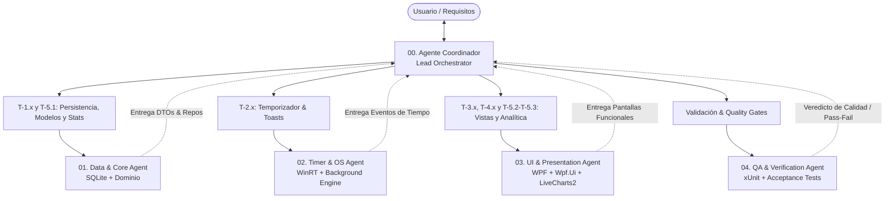

# Especificación de Agente Coordinador y Subagentes
## Sistema de Ejecución Multi-Agente para StudyProgrammer

Este documento y los archivos en `.specify/agents/` definen el equipo de agentes autónomos para la construcción y evolución del proyecto. Está diseñado en un formato declarativo agnóstico (**YAML frontmatter + Markdown**) para ser consumible por cualquier harness de agentes (Antigravity, Claude Code, Cursor, Copilot Workspace, OpenAI Swarm, AutoGen o Aider).

---

## 1. Topología del Equipo de Agentes



---

## 2. Matriz de Responsabilidades y Límites (Boundaries)

| Agente | Alcance Exclusivo | Límites Estrictos (NO TOCAR) | Archivos de Contexto Clave |
| :--- | :--- | :--- | :--- |
| **00. Coordinator (Lead)** | Orquestación, lectura de `tasks.md`, asignación de tareas, control de ramas git y gates de aprobación. | No implementa código de bajo nivel si un subagente está asignado. | `spec.md`, `plan.md`, `tasks.md`, `constitution.md` |
| **01. Data & Core** | `StudyTracker.Core/Models`, `Data/`, `Services/StatsService.cs`, SQLite DDL, scripts de migración. | No toca archivos XAML ni llamadas a APIs de UI de Windows. | `data-model.md`, `contracts/interfaces.md` |
| **02. Timer & OS** | `StudyTracker.Core/Services/TimerService.cs`, `WindowsNotificationService.cs`, eventos WinRT. | No toca vistas ni consultas SQL directas. | `contracts/interfaces.md`, `spec.md` |
| **03. UI & Presentation** | `StudyTracker.UI/Views`, `ViewModels`, `Controls`, estilos Fluent (Mica/Acrílico), LiveCharts. | No escribe consultas SQL directas ni lógica de SQLite (consume solo interfaces del Core). | `plan.md`, `contracts/interfaces.md` |
| **04. QA & Verifier** | `tests/StudyTracker.Core.Tests/`, verificación de escenarios *Given-When-Then*, límites de RAM y benchmarks. | No modifica la lógica de negocio para hacer pasar pruebas; solo reporta discrepancias. | `spec.md`, `constitution.md` |

---

## 3. Protocolo Universal de Pasaje de Estado (Handover Protocol)

Cada subagente debe estructurar su respuesta hacia el coordinador siguiendo este esquema JSON/Markdown estándar:

```markdown
### Reporte de Finalización de Tarea: [ID_TAREA]
- **Agente**: [data-core | timer-notifications | ui-presentation | qa-verification]
- **Estado**: [COMPLETADO | BLOQUEADO | REQUIERE_CLARIFICACION]
- **Archivos Creados/Modificados**:
  - `ruta/al/archivo.cs`
- **Pruebas Ejecutadas**: [X pasadas, 0 fallidas]
- **Contratos Expuestos / Cambios**:
  - `IInterface`: descripción del cambio
- **Próxima Acción Sugerida**: [Siguiente tarea o retorno al Coordinador]
```

---

## 3.1. Protocolo de Commit por Tarea (obligatorio)

Ninguna tarea se marca como completada con `git commit` manual. El cierre de cada tarea pasa por el script de quality gate:

```powershell
studyProgrammer/.specify/scripts/powershell/complete-task.ps1 `
  -TaskId T-1.3 -Type feat -Scope core `
  -Message "modelos Topic y StudySession" `
  -Agent 01-data-core
```

### Comandos Git canónicos

Los scripts `complete-task.ps1` y `commit-task.ps1` ejecutan **exactamente** esta secuencia desde la raíz del repositorio:

```powershell
# 1. Preparar todos los cambios de la tarea
git add .

# 2. Crear el commit (asunto + cuerpo con el trailer Task:)
git commit -m "<tipo>(<ámbito>): <T-x.y> <descripción>

Task: <T-x.y>
Agent: <agente>
Tests: <estado>
Build: <estado>"

# 3. Publicar en la rama principal
git push origin main
```

En el primer push de una rama nueva (sin upstream) el script usa `git push -u origin main`; a partir de ahí usa siempre `git push origin main`.

Reglas:

1. `complete-task.ps1` ejecuta `dotnet build` y `dotnet test` **antes** de marcar `[x]` en `tasks.md`. Si el gate falla, `tasks.md` no se modifica.
2. El commit sigue *Conventional Commits* y el cuerpo incluye `Task: T-x.y`, `Agent:` y el estado de build/tests.
3. Los scripts son los únicos autorizados a ejecutar `git add .`, `git commit -m` y `git push origin main`. Usa `-NoPush` para commits solo locales.
4. Para commits de andamiaje previos a la primera tarea usar `commit-task.ps1 -TaskId T-0.0 -Type chore -Scope setup -All`.
5. El commit lo crea el script, no el agente: nunca ejecutar `git add` + `git commit` sueltos si existe una tarea asociada.
6. La rama de publicación es `main`; los scripts abortan si el HEAD está en una rama distinta.
7. `MEMORY.md` (raíz del repositorio) es el **libro único de desarrollo**: se lee al iniciar la sesión y se actualiza al cerrar cada tarea (progreso por fase, bitácora, próxima acción y ADR). No crear memorias por submódulo.

---

## 3.2. Ejecución real en opencode (local)

Las fichas de §4 son la fuente canónica de roles. La capa operativa de opencode vive en `.opencode/agents/` y está **ignorada por Git** (`.opencode/` en `.gitignore`); se recrea desde esta sección y las fichas canónicas.

| Rol canónico | Agente opencode | Modo | Edición permitida | Puede delegar |
| :--- | :--- | :--- | :--- | :--- |
| 00 Coordinator | `coordinator` | `primary` | `MEMORY.md`, `tasks.md` | `data-core`, `timer-notifications`, `ui-presentation`, `qa-verification`, `explore` |
| 01 Data & Core | `data-core` | `subagent` | `Core/Models`, `Core/Data`, `I*Repository`, `IStats*`, `Services/Stats*` | No |
| 02 Timer & OS | `timer-notifications` | `subagent` | `Core/Services/Timer*`, `*Notification*`, `Core/Notifications`, interfaces afines | No |
| 03 UI & Presentation | `ui-presentation` | `subagent` | `src/StudyTracker.UI/**` | No |
| 04 QA & Verification | `qa-verification` | `subagent` | `tests/**`; nunca producción | No |

Correspondencia de herramientas: `read_file` → `read`, `write_file`/`edit_file` → `edit`, `run_command` → `bash`, `invoke_subagent` → `task`. La delegación se hace con `task` y `subagent_type`.

Ruteo corregido:

- `T-1.x` y `T-5.1` → `data-core`.
- `T-2.x` → `timer-notifications`.
- `T-3.x`, `T-4.x`, `T-5.2-T-5.3` → `ui-presentation`.
- `T-5.4` y la validación de cualquier tarea → `qa-verification`; el cierre final siempre lo hace `coordinator`.

Reglas de permisos:

- `coordinator` no puede editar código; solo documentación de estado y cierre. Puede ejecutar build/test y los scripts de cierre, pero no `git add`/`commit`/`push` directos.
- Los subagentes no pueden delegar ni preguntar al usuario: devuelven `REQUIERE_CLARIFICACION` al coordinador. Tampoco pueden hacer commits ni ejecutar los scripts de cierre.
- `.opencode/opencode.json` fija `default_agent: coordinator` solo en esta máquina. Si un clon no tiene `.opencode/`, opencode cae en `build` con una advertencia; recrea los agentes locales con esta sección.

---

## 4. Directorio de Especificaciones de Agentes

Las especificaciones individuales ejecutables residen en:
* [`00-coordinator.agent.md`](file:///c:/Users/jeffr/OneDrive/Documentos/INFORMATICA/PROYECTOS_EN_DESARROLLO/programadorDeEstudios/studyProgrammer/.specify/agents/00-coordinator.agent.md)
* [`01-data-core.agent.md`](file:///c:/Users/jeffr/OneDrive/Documentos/INFORMATICA/PROYECTOS_EN_DESARROLLO/programadorDeEstudios/studyProgrammer/.specify/agents/01-data-core.agent.md)
* [`02-timer-notifications.agent.md`](file:///c:/Users/jeffr/OneDrive/Documentos/INFORMATICA/PROYECTOS_EN_DESARROLLO/programadorDeEstudios/studyProgrammer/.specify/agents/02-timer-notifications.agent.md)
* [`03-ui-presentation.agent.md`](file:///c:/Users/jeffr/OneDrive/Documentos/INFORMATICA/PROYECTOS_EN_DESARROLLO/programadorDeEstudios/studyProgrammer/.specify/agents/03-ui-presentation.agent.md)
* [`04-qa-verification.agent.md`](file:///c:/Users/jeffr/OneDrive/Documentos/INFORMATICA/PROYECTOS_EN_DESARROLLO/programadorDeEstudios/studyProgrammer/.specify/agents/04-qa-verification.agent.md)
